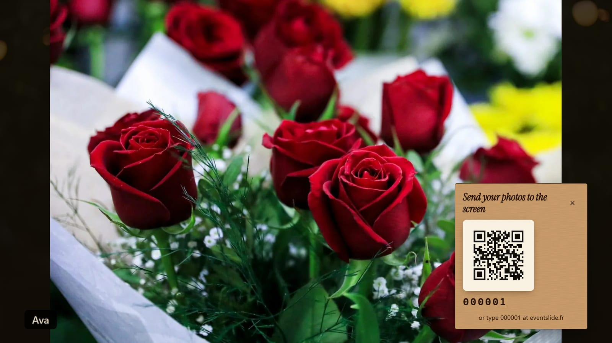
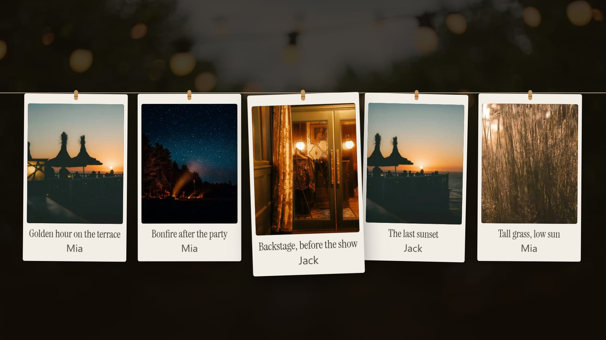
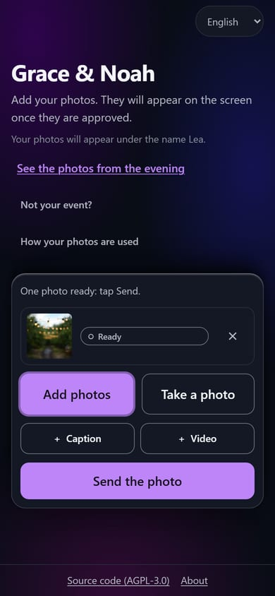
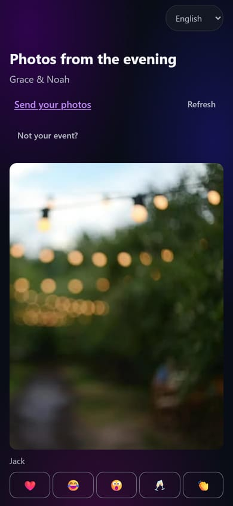
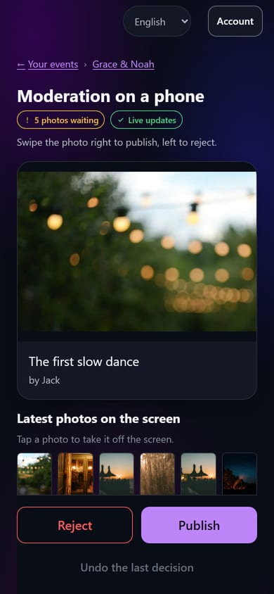
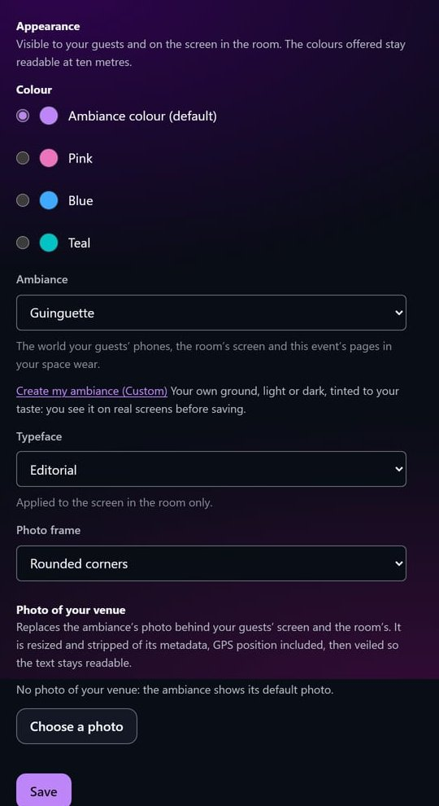
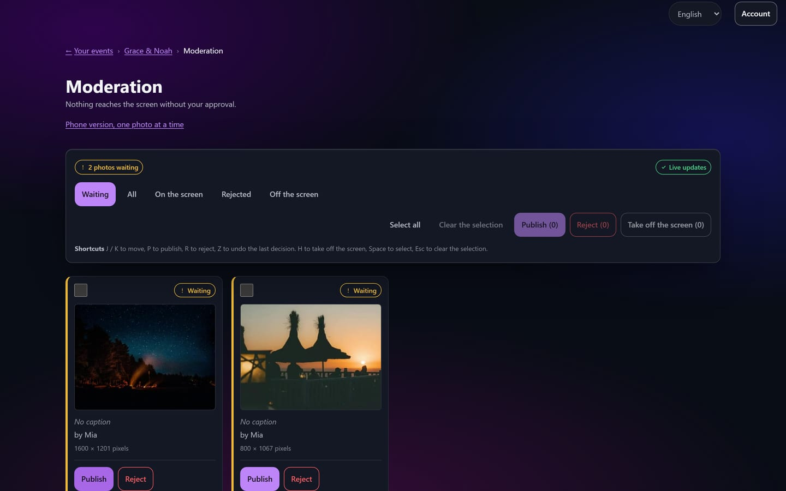
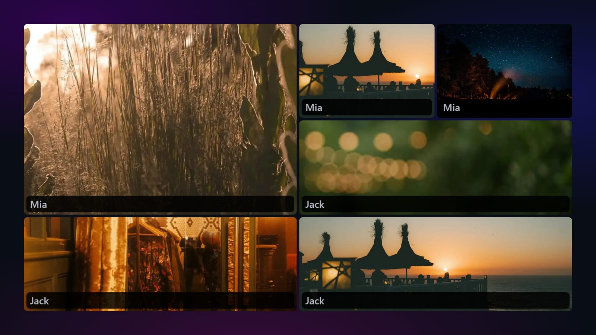

# EventSlide

**A live photo wall for your event.** Guests scan a QR code and send photos from their
phone, with no account and no app. You approve them, and they appear on the projector
within seconds.

<p align="center">
  
  
</p>
<p align="center">
  
  
  
  
</p>

Self-hosted, so the photos stay on your machine. Or, if you would rather not run a server,
use the free hosted instance: see [Try it](#try-it).

## Try it

**Hosted.** The maintainer runs one free instance of the same software at
[app.eventslide.fr](https://app.eventslide.fr), by invitation. Ask for access on
[eventslide.fr](https://eventslide.fr/en/request-access/), where you will also find how it
works and some guides.

**Self-hosted, with Docker.** You need Docker and an https address your guests' phones can
reach (see [What the install needs](#what-the-install-needs)).

```bash
git clone https://github.com/Irony42/EventSlide.git
cd EventSlide

# Two secrets, and the address your guests' phones will reach.
node -e "console.log('SESSION_SECRET='+require('crypto').randomBytes(48).toString('base64url'))" >> .env
node -e "console.log('GUEST_TOKEN_SECRET='+require('crypto').randomBytes(48).toString('base64url'))" >> .env
echo "PUBLIC_URL=https://photos.example.com" >> .env
# Your own account, created on the first boot, with a generated password.
echo "BOOTSTRAP_OWNER_EMAIL=you@example.com" >> .env
node -e "console.log('BOOTSTRAP_OWNER_PASSWORD='+require('crypto').randomBytes(18).toString('base64url'))" >> .env

docker compose up            # the first time, and read what it says
docker compose up -d         # once it has booted cleanly
```

The image is `ghcr.io/irony42/eventslide` (`linux/amd64` and `linux/arm64`), signed and
scanned at each release; [docs/IMAGE-SOURCES.md](docs/IMAGE-SOURCES.md) says what is in it
and how to verify it. To build it from the checkout instead:
`docker compose -f compose.yaml -f compose.build.yaml up --build`.

Then open `PUBLIC_URL/login` and sign in with that email and the generated password
(`grep BOOTSTRAP_OWNER .env` shows it). The first sign-in asks you to choose your own.

### What the install needs

- **Run it in the foreground the first time.** A missing or malformed variable makes the
  server print every problem at once and exit. Once it boots, use `-d`.
- **`PUBLIC_URL` must be an https address a phone on the venue Wi-Fi can reach**, never
  `localhost`: it is what the QR code encodes. Scan your own QR code before the guests arrive.
- **Something in front of it terminates https** (Caddy, nginx or Traefik), because the
  host's login cookie is `Secure`. `compose.yaml` binds `127.0.0.1:4300` and sets
  `TRUST_PROXY_HOPS=1` to match. With Caddy, the whole proxy is:

  ```
  photos.example.com {
    reverse_proxy 127.0.0.1:4300
  }
  ```

  nginx also needs `proxy_set_header X-Forwarded-Proto $scheme;` and
  `proxy_set_header X-Forwarded-For $proxy_add_x_forwarded_for;`.

- **There is no default admin and no weak default secret.** The owner above is made on the
  first boot against an empty database, and a server started without its two secrets
  refuses to run. [`.env.example`](.env.example) walks through every other setting
  (upload limits, retention, video clips, the shared gallery).

Without Docker, behind a venue with no domain name, or to look around with demo data:
[docs/INSTALL.md](docs/INSTALL.md).

## What it does

**For your guests**: scan, type a first name if they like, send. No account, no download,
no email. Photos and short video clips, a caption, a checklist of photo missions if you set
some, a reaction under someone else's photo, and a feed of the evening's photos. Uploads
queue on the phone when the Wi-Fi drops. It speaks French, English, Spanish, German and
Italian.

**For you, the host**: nothing reaches the screen until you approve it, from a laptop
(`J`/`K`, `P` to publish, `R` to refuse) or from your phone, one photo at a time.

<p align="center">
  
</p>

Each event wears an ambiance, the violet EventSlide look by default, one of six designed
worlds, or one you make yourself, with an accent colour, a typeface and a frame for the
photos. The morning after, one link shares the album with everyone, optionally behind a
password.

**For the room**: the wall, fullscreen on a projector, runs unattended for an evening.
Seven layouts (spotlight, mosaic, polaroid, filmstrip, collage, split and clothesline),
captions and names, a QR code and a join code in the corner for whoever arrives late. It
keeps playing if the network drops.

<p align="center">
  
</p>

Every feature, in full: [docs/FEATURES.md](docs/FEATURES.md). Running the evening
(missions, the shared gallery, retention, schedules): [docs/OPERATING.md](docs/OPERATING.md).

## Privacy

- **Location data and device identifiers are stripped** from every photo on arrival.
- **Moderation comes first.** Approving each photo is the default.
- **Guests are told before their first photo** who sees it, how long it is kept and how to
  have it removed, and a guest can erase everything they sent.
- **Retention is yours to set**, and the server purges what is due. Nothing is deleted
  unless you ask.
- **Open source, AGPL-3.0-only.** The photos stay on a machine you control.

## Backups

Take one before the event and one the morning after. The server stays up while you do.

```bash
docker compose exec eventslide node dist/ops/scripts/backup.js
```

It prints the archive's name. Copy it off the machine before you delete it from the volume:
until then it is on the same disk as the photographs. Restoring, the USB-drive variant and
the npm scripts are in [docs/OPERATING.md](docs/OPERATING.md#backups).

## Upgrading

Run a tagged release, not the tip of `main`, and take a backup first: migrations only go
forward.

```bash
git fetch --tags && git checkout vX.Y.Z
docker compose pull
docker compose up -d
```

What a major version may break, and how to go back: [docs/UPGRADING.md](docs/UPGRADING.md).
What changed: [CHANGELOG.md](CHANGELOG.md).

## Contributing

Start with [CONTRIBUTING.md](CONTRIBUTING.md). The rest is documented rather than left to
be inferred:

|                                                |                                                                                      |
| ---------------------------------------------- | ------------------------------------------------------------------------------------ |
| [CLAUDE.md](CLAUDE.md)                         | The rules, the layer boundaries, and the traps this codebase has already fallen into |
| [AGENTS.md](AGENTS.md)                         | The same, for any AI coding agent                                                    |
| [docs/ARCHITECTURE.md](docs/ARCHITECTURE.md)   | Layers, a guest upload traced file by file, the ports, the schema                    |
| [docs/TESTING.md](docs/TESTING.md)             | Six test rings and which one a given test belongs in                                 |
| [docs/SECURITY.md](docs/SECURITY.md)           | The threat model, written around who is actually in the room                         |
| [docs/DESIGN-SYSTEM.md](docs/DESIGN-SYSTEM.md) | Tokens, primitives, and the accessibility contract                                   |
| [docs/API.md](docs/API.md)                     | The HTTP contract                                                                    |
| [docs/ROADMAP.md](docs/ROADMAP.md)             | What comes next, and what will never be built                                        |
| [docs/adr/](docs/adr/)                         | Why the architecture is the way it is, including the alternatives that lost          |

```bash
npm run dev            # API on :4300, web on :5173
npm run verify         # lint + typecheck + coverage + build — the gate
npm run verify:full    # the above plus the Playwright journeys
```

## Licence

**AGPL-3.0-only**, no "or later" clause: the full text is in [LICENSE](LICENSE), and
[NOTICE](NOTICE) names the third-party components that stay under their own licences. Run
it, read it, change it and pass it on; if you let others use a modified version over a
network, ship them its source. What that asks of someone who runs, changes or forks it:
[docs/LICENSING-FAQ.md](docs/LICENSING-FAQ.md). The history of the licence, the settings
for an instance run for other people, and how dependencies are held to the same standard:
[docs/LICENCE.md](docs/LICENCE.md).

The screenshots above use the Unsplash photographs credited in
[web/public/licenses/PHOTOS.txt](web/public/licenses/PHOTOS.txt).
